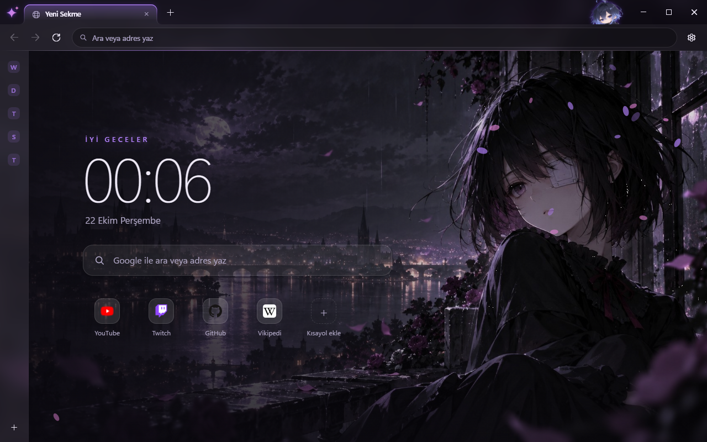
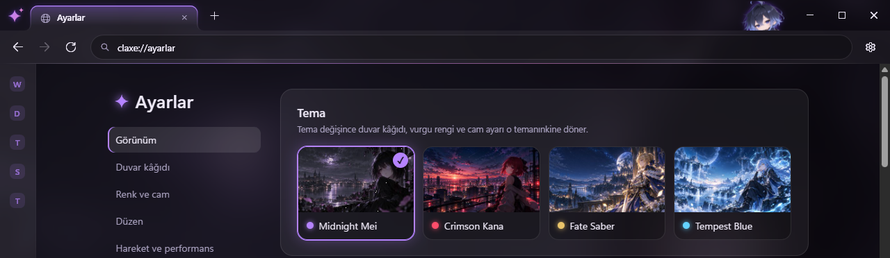

# Claxe Browser

> **EN:** Claxe is a personal, anime-styled web browser for Windows 11, built with C# / .NET 10 / WPF on top of
> Microsoft WebView2 (Chromium). Glassy themed UI, a mascot that peeks over the toolbar, web panels, an InPrivate mode,
> encrypted history and session cookies. The interface is in Turkish.

Anime estetiğini modern masaüstü tasarımıyla birleştiren, kişisel kullanım için geliştirilmiş Windows tarayıcısı.
C# / .NET 10 / WPF + Microsoft WebView2 (Chromium).




## Özellikler

- **Görünüm:** 4 tema (Midnight Mei, Tempest Blue, Fate Saber, Crimson Kana), cam efektli sekme ve araç çubuğu,
  kavisli neon aktif sekme, vurgu rengi, saydamlık, köşe stili ve yoğunluk ayarları, kendi duvar kâğıdını yükleme
- **Maskot:** Araç çubuğunun arkasından bakar; sayfa yüklenince sevinir, uzun süre boşta kalınca uyur (kapatılabilir)
- **Yeni sekme:** Saat, arama, eklenip silinebilen kısayollar, temaya göre yaprak / kıvılcım / kabarcık efektleri
- **Gezinme:** Adres çubuğu önerileri (yerel), sayfada bul, yakınlaştırma göstergesi, temalı sağ tık menüleri,
  özel hata sayfası
- **Sekmeler:** Sürükle-sırala, sabitleme, ses göstergesi ve sessize alma, gizli (InPrivate) sekmeler, arka plan
  sekmelerini uyutma, oturum geri yükleme
- **Kitaplık:** Geçmiş, klasörlü yer imleri, kendi indirme yöneticisi
- **Web panelleri:** WhatsApp, Discord, Telegram, Spotify, Twitch ve kendi panellerin; sol ya da sağ kenarda
- **Gizlilik:** Geçmiş ve oturum çerezleri Windows hesabına bağlı şifrelenir (DPAPI), site izinleri hatırlanır,
  tarama verileri zaman aralığıyla temizlenir, telemetri yok
- **İçe aktarma:** Chrome, Opera GX, Edge, Brave, Opera, Vivaldi ve Firefox'tan yer imleri ve geçmiş
- **Diğer:** Varsayılan tarayıcı olabilme, tek pencere, arayüz sesleri, performans modu, otomatik güncelleme

## Kurulum

Releases sayfasındaki `ClaxeBrowser-win-Setup.exe` dosyasını çalıştır. .NET kurulu olması gerekmez; WebView2 Runtime
Windows 11'de hazır gelir. Claxe `%LOCALAPPDATA%\ClaxeBrowser` klasörüne kurulur ve yeni sürümleri kendisi indirir
(Ayarlar → Hakkında).

## Kaynaktan derleme

```bash
dotnet run --project src/Claxe
```

Gereksinimler: Windows 10/11, .NET 10 SDK.

Kurulum dosyası üretmek için ([Velopack](https://velopack.io)):

```bash
dotnet tool install -g vpk
```

```bash
powershell -File build/pack.ps1 -Version 0.2.0
```

Çıktı `artifacts/releases` klasörüne yazılır.

> Hazır duvar kâğıtları depoda yoktur; yalnızca dört temanın görselleri ve maskot depodadır.
> Kendi görsellerini `src/Claxe/Assets/Wallpapers` klasörüne `.jpg` olarak (ve `thumbs/` altına küçük önizlemesini)
> koyabilir ya da uygulamadan "Görsel yükle" ile ekleyebilirsin.

## Klavye kısayolları

| Kısayol | İşlem |
|---|---|
| Ctrl+T / Ctrl+Shift+N | Yeni sekme / yeni gizli sekme |
| Ctrl+W / Ctrl+Shift+T | Sekmeyi kapat / son kapatılanı geri aç |
| Ctrl+Tab / Ctrl+Shift+Tab | Sonraki / önceki sekme |
| Ctrl+1…8, Ctrl+9 | Sekmeye git, son sekme |
| Ctrl+L / Alt+D / F6 | Adres çubuğu (↑ ↓ ile öneriler) |
| Ctrl+F | Sayfada bul (Enter / Shift+Enter: sonraki / önceki) |
| F5 / Ctrl+R | Yenile |
| Alt+Sol / Alt+Sağ | Geri / ileri |
| Ctrl+D | Yer imlerine ekle / çıkar |
| Ctrl+H / Ctrl+J / Ctrl+Shift+O | Geçmiş / İndirmeler / Yer imleri |
| Ctrl+, / Ctrl+Shift+Del | Ayarlar / Tarama verilerini temizle |
| F11 | Tam ekran |

## Proje yapısı

```
src/Claxe/
  Core/        MVVM temel sınıfları
  Models/      Ayar, oturum ve tema modelleri
  Services/    Tema, geçmiş, yer imleri, indirmeler, izinler, içe aktarma, güncelleme, ...
  ViewModels/  Ana pencere, sekme, panel, maskot, ayarlar
  Views/       Ana pencere
  Controls/    Sekme şeridi, sekme şekli, maskot
  Themes/      Tasarım anahtarları ve kontrol stilleri (WPF)
  Pages/       Uygulamanın kendi sayfaları: yeni sekme, ayarlar, kitaplık (HTML/CSS/JS)
  Assets/      Tema görselleri ve JSON'ları, maskot, simge
build/pack.ps1 Kurulum dosyası
```

## Veriler ve gizlilik

Kullanıcı verileri `%LOCALAPPDATA%\Claxe` altındadır (program ise `%LOCALAPPDATA%\ClaxeBrowser` altına kurulur;
kaldırmak verileri silmez).

| Dosya | İçerik | Biçim |
|---|---|---|
| `history.dat` | Tarama geçmişi (10.000 kayıt / 180 gün) | DPAPI ile şifreli |
| `session-cookies.dat` | Kapanışta kaydedilen oturum çerezleri (tek kullanımlık, 14 gün) | DPAPI ile şifreli |
| `settings.json`, `bookmarks.json`, `downloads.json`, `permissions.json`, `panels.json`, `shortcuts.json` | Ayarlar ve listeler | JSON |
| `WebView2\` | Chromium profili (kalıcı çerezler, önbellek) | WebView2 |

Şifre kaydetme kapalıdır. Başka tarayıcılardan çerez ve şifre aktarılmaz (Chromium bunları yalnızca kendisinin
çözebileceği şekilde şifreler). Geliştirme ve test için `CLAXE_PROFILE_DIR` ortam değişkeni ayrı bir profil klasörü
gösterebilir.

## WebView2'nin Chrome'dan farkları

- Siteler tarayıcıyı Microsoft Edge olarak görür (motor Edge'in motorudur; uyumluluk açısından avantajlıdır).
- Chrome Web Mağazası eklentileri kurulamaz.
- Oturum çerezlerini WebView2 kendisi saklamaz; Claxe bunları kapanışta şifreleyip açılışta geri yükler.
- Tarayıcı süreci çökerse Claxe yeni bir süreç başlatır ve sekmeleri yeniden yükler.

## Lisans

© 2026 Claxe. Tüm hakları saklıdır. Bu depo yalnızca incelenmek içindir; kod ve görseller izin alınmadan
kopyalanamaz, dağıtılamaz veya başka projelerde kullanılamaz.
